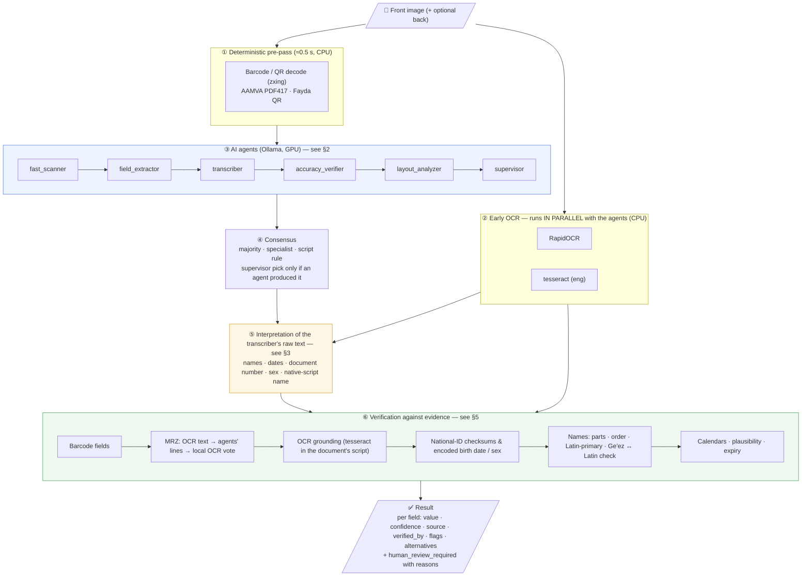
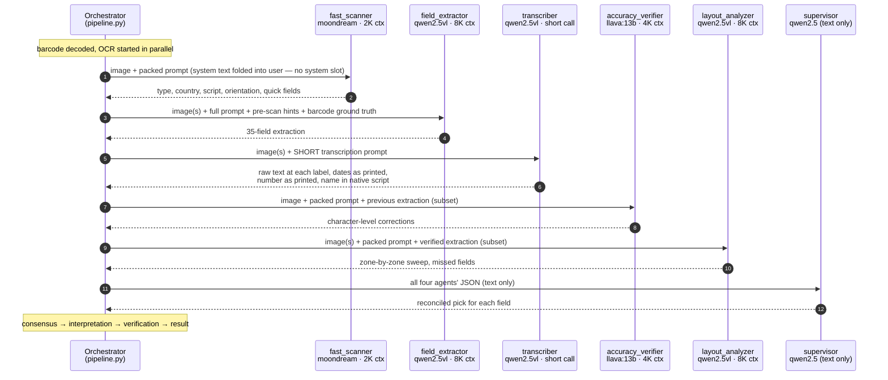
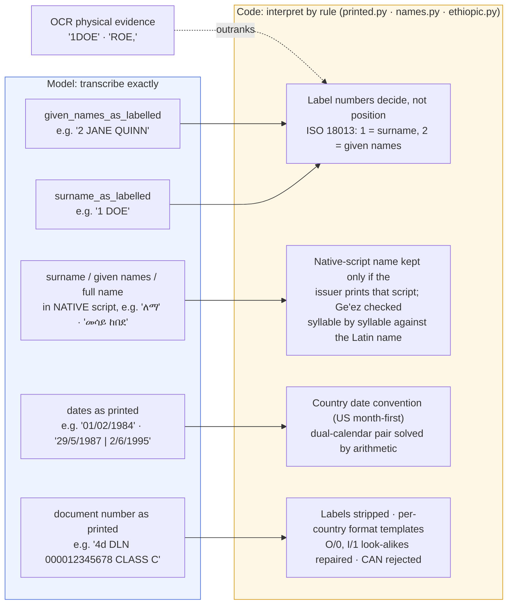
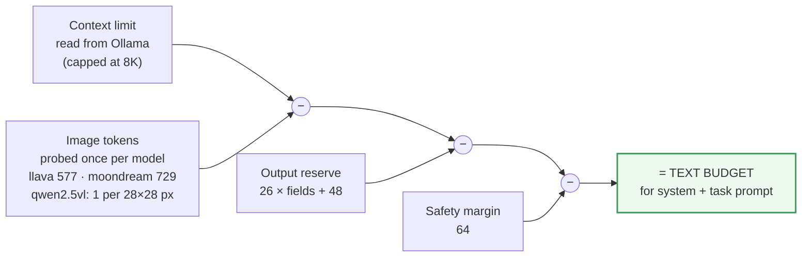
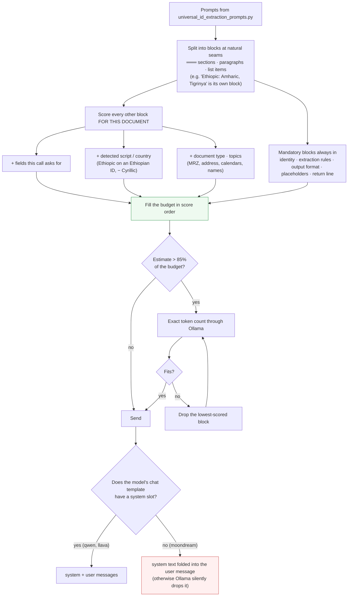
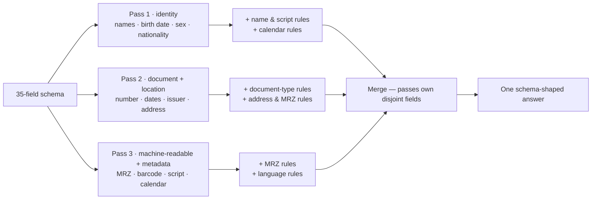
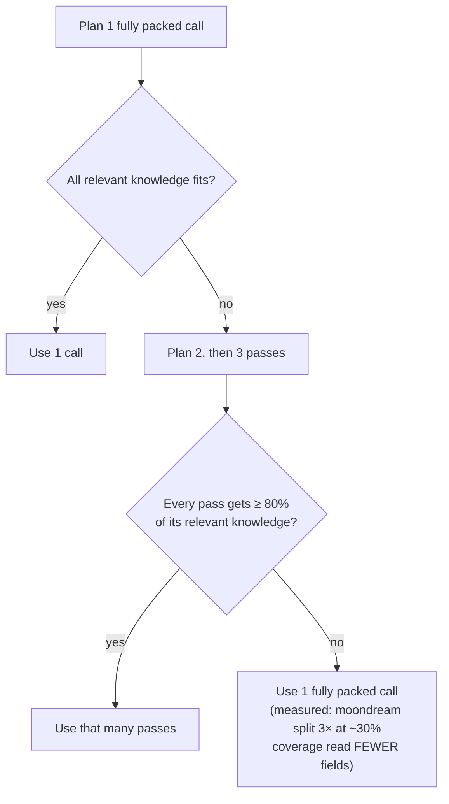
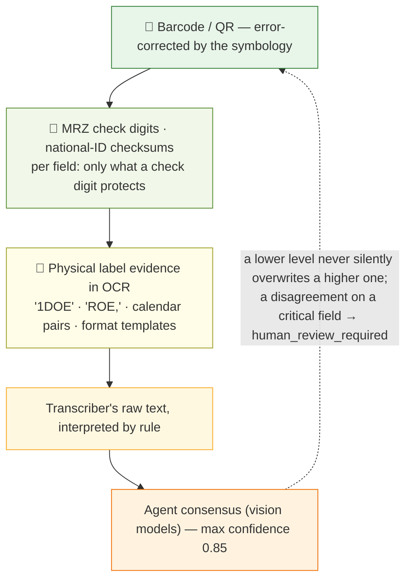
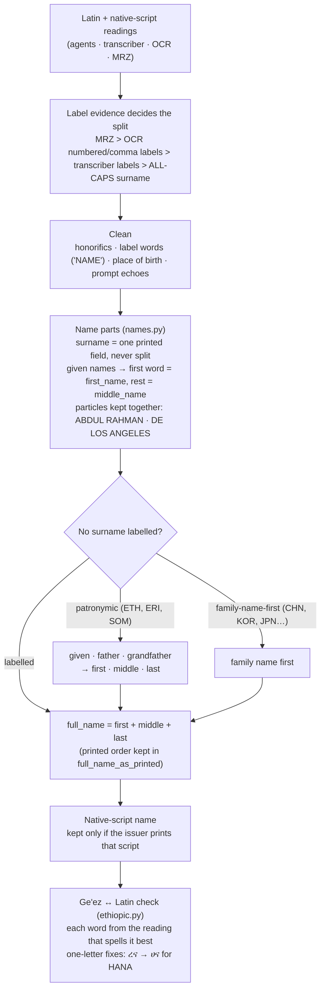

# Universal Engine — How the Agents Work Together

This document explains the universal ID extraction engine (`universal/`, served
at `/universal/*`) in diagrams: how the AI agents pass work to each other, where
the **transcriber** fits, how every value is checked by deterministic code, and
how the engine gets full use out of small-context models.

> One idea runs through the whole design: **the models read, the code decides.**
> Vision models are good at reading what is printed and unreliable at
> interpreting it (name order, date conventions, calendars, which number is the
> document number). So the models transcribe and propose, and deterministic code
> interprets and verifies against evidence that doesn't come from a language
> model: check digits, barcodes, OCR, calendar arithmetic.

Contents:

1. [End-to-end flow](#1-end-to-end-flow)
2. [How the agents talk to each other](#2-how-the-agents-talk-to-each-other)
3. [The transcriber: the model reads, the code decides](#3-the-transcriber-the-model-reads-the-code-decides)
4. [Solving the token limit of small models](#4-solving-the-token-limit-of-small-models)
5. [Evidence precedence: who wins a disagreement](#5-evidence-precedence-who-wins-a-disagreement)
6. [From raw readings to name parts](#6-from-raw-readings-to-name-parts)
7. [Reading the result](#7-reading-the-result)

---

## 1. End-to-end flow



**Two modes.** Both run steps ①, ②, ④, ⑤ and ⑥ in full:

| Mode | Agents run | Typical time |
|---|---|---|
| `fast` | field_extractor + transcriber | ≈ 15–30 s |
| `full` | all six (the five from the prompts file + the transcriber) | ≈ 90–120 s |

---

## 2. How the agents talk to each other

The agents run **one after another**. Each sees the document image(s) plus a
distilled version of what the earlier agents found. None of them talks to
another directly: the orchestrator (`pipeline.run_agents`) builds every message
and merges the answers.



What each agent receives and returns:

| # | Agent | Model | Sees | Returns | Mode |
|---|---|---|---|---|---|
| 1 | fast_scanner | moondream | image | document type, country, script, orientation, quick fields | full |
| 2 | field_extractor | qwen2.5vl:7b | image(s) · pre-scan hints · **barcode data as ground truth** | the 35-field schema | fast + full |
| + | **transcriber** | qwen2.5vl:7b | image(s) · short prompt | raw text only: surname / given names at their labels (Latin **and** native script), dates exactly as printed, document number as printed, sex, other labelled numbers | fast + full |
| 3 | accuracy_verifier | llava:13b | image · the extraction so far | corrections of look-alike characters, MRZ check | full |
| 4 | layout_analyzer | qwen2.5vl:7b | image(s) · the verified extraction | fields hidden in stamps, margins, back side | full |
| 5 | supervisor | qwen2.5:7b | the four agents' answers (no image) | one pick per field | full |

**Guard-rails on the conversation:**

- **Supervisor picks are checked.** A value the supervisor picks is accepted only if at least one agent actually read it. A value no agent produced is a hallucination and is rejected in code.
- **Each agent sees only relevant earlier data.** Earlier results are passed as a compact subset (non-empty fields only, and only the fields that agent's pass owns), which keeps small models inside their budget.
- **Agents don't vote for each other.** The later agents see earlier answers, so their agreement isn't independent. Only the scanner and the extractor count as independent readers when the engine decides whether a value is a hallucination.

---

## 3. The transcriber: the model reads, the code decides

Tested on 31 real documents, the agents **read** well but **interpreted** badly:

- surname taken as the last word by position
- `01/02/1984` read day-first on a US card
- the 6-digit CAN taken as the document number
- an Ethiopian-calendar date passed off as Gregorian

Asking for raw text *inside* the 5,000-token extraction prompt didn't work (the
model echoed its own guess), so the transcriber is a **separate, short call**.



Examples of the code deciding:

| The model transcribed | The code concluded | Rule |
|---|---|---|
| `01/02/1984` on a US card | 1984-01-02 | US prints month-first |
| `29/5/1987 \| 2/6/1995` (Ethiopian licence) | 1995-02-06 | 29/5/1987 EC converts to 6 Feb 1995, so the Gregorian half is month-first |
| `MR JOHN PAUL` | first JOHN, middle PAUL | honorifics dropped |
| `4d DLN 000012345678 CLASS C` | `000012345678` | label words stripped |
| `CA123450A` (Italy) | `CA12345OA` | template `AA99999AA`: a zero in a letter slot is an O |
| `ረና` next to Latin `HANA` | `ሀና` | ረ spells "re"; ሀ spells "ha" |

---

## 4. Solving the token limit of small models

Three of the models have small context windows. llava is 4,096 tokens and
moondream only 2,048, and part of that goes to the image and to the answer.
Rather than truncating the prompts to a fixed "compact" version, the engine
**measures the real budget of every call and packs it with the most relevant
knowledge.**

### 4.1 The budget of one call



Worked numbers (image counts as measured on this Mac):

| Call | Context | Image | Output reserve | Margin | **Text budget** |
|---|---:|---:|---:|---:|---:|
| fast_scanner · moondream (14 fields) | 2,048 | 729 | 412 | 64 | **843** |
| accuracy_verifier · llava:13b (35 fields) | 4,096 | 577 | 958 | 64 | **2,497** |
| field_extractor · qwen2.5vl (35 fields, 1600×1000 image) | 8,192 | 2,090 | 958 | 64 | **5,080** |
| supervisor · qwen2.5 (37 fields, no image) | 8,192 | 0 | 1,010 | 64 | **7,118** |

The system prompt alone is about 1,800 tokens, so it can't fit moondream's 843.
That's why packing is needed.

### 4.2 Packing the budget with the most relevant knowledge



### 4.3 One model, several passes

When everything relevant doesn't fit in one call, the same model can run
**2–3 times**, each pass owning a group of fields and carrying the knowledge
for those fields. The results are merged, so the model behaves like one with a
larger context.



**How `auto` chooses** (`agent_passes=auto|1|2|3`):



With the current prompts, `auto` makes one fully packed call per agent:

- llava now gets its complete relevant prompt, about 3,050 of 4,096 tokens (it used to get about 1,960).
- moondream now actually receives its instructions (they were being dropped).

Forcing 2 or 3 passes is still available for longer custom prompts.

**Other measures that keep the budgets real:**

- **Context sizes are fixed.** Probes and real calls use the same context size, because Ollama reloads a model whenever the size changes.
- **Large models are capped at 8K.** At 16K, qwen2.5vl grew to 7.8 GB and the models stopped fitting together in 17.8 GB of GPU memory.
- **Images are shrunk before encoding.** They're EXIF-rotated and scaled down to 1,600 px, so a 12 MP phone photo doesn't waste thousands of vision tokens.
- **Answers are JSON-schema-constrained.** Every answer has exactly the keys asked for, with no prose and no markdown.

---

## 5. Evidence precedence: who wins a disagreement



**Special cases:**

- **MRZ names.** The MRZ's name line has no check digit. The MRZ decides which words are the surname, but it never replaces the visual spelling. When the two OCR engines read the name line differently, a local OCR re-read with per-character voting settles it.
- **MRZ read from OCR.** The MRZ is found straight from the OCR text of every image, including a card's back, without waiting for an agent to transcribe it. Lines from the two OCR engines are combined by role, and the check digits pick the combination that is right.
- **Rejected values are kept.** Every rejected value stays in `alternatives`, so no correction is silent.

---

## 6. From raw readings to name parts



---

## 7. Reading the result

Every field in `fields` carries its own evidence trail:

```json
"last_name": {
  "value": "LEMMA",
  "confidence": 0.99,
  "source": "mrz",
  "verified_by": ["mrz", "ocr"],
  "alternatives": ["LEMA"],
  "flags": []
}
```

| Key | Meaning |
|---|---|
| `source` | Where the final value came from: `mrz`, `barcode`, `printed_labels`, `ocr_numbered_labels`, `format_template`, `calendar_arithmetic`, `supervisor`, `consensus`… |
| `verified_by` | Every independent check the value passed |
| `alternatives` | Every value it replaced; nothing is silently discarded |
| `flags` | Why something changed, e.g. `reinterpreted_from_printed`, `corrected_by_latin_spelling`, `dropped_possible_hallucination` |

Document-level keys:

- **`human_review_required`** always comes with plain-language `review_reasons`.
- **`timings_seconds`** breaks each run down by stage.
- **The agent log** shows the number of passes, the knowledge coverage, and planned vs. actual tokens for every call.
